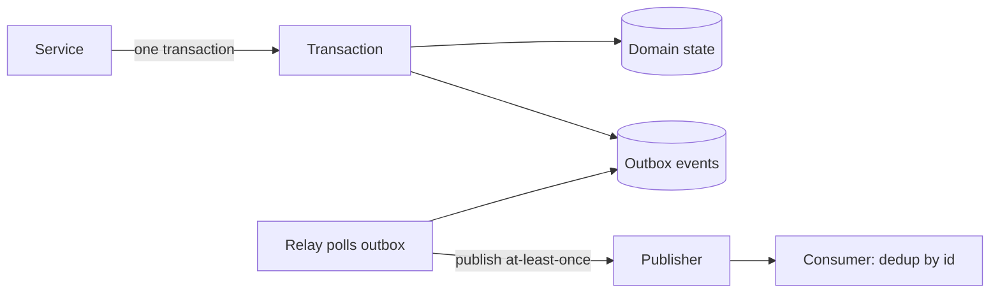

<p align="center">
  
</p>

<h1 align="center">Outbox Pattern</h1>

<p align="center">
  <strong>Transactional outbox pattern — reliable event publishing with a relay and dedup — in Python.</strong><br>
  Commit domain state and its events in one transaction, then relay them at-least-once to any broker.
</p>

<p align="center">
  <em>Built and maintained by <a href="https://viprasol.com">Viprasol Tech</a> — Fintech Experts. Full-Stack Builders.</em>
</p>

<p align="center">
  <a href="https://github.com/Viprasol-Tech/outbox-pattern/actions/workflows/ci.yml"></a>
  <a href="LICENSE"></a>
  
  <a href="https://t.me/viprasol_help"></a>
  <a href="https://github.com/Viprasol-Tech/outbox-pattern/stargazers"></a>
</p>

---

## Why the outbox pattern?

Writing to your database **and** publishing to a message broker are two
independent operations. If the broker is down (or the process dies) between
them, you either lose the event or publish an event for state that never
committed. The **transactional outbox** fixes this: record the event in an
`outbox` table inside the *same* local transaction as your domain write, then
let a separate **relay** publish those events asynchronously. State and events
commit or roll back together — nothing is lost, nothing is phantom-published.

## ✨ Features

- 🔁 **Atomic state + event** — one `Transaction` commits domain data and its outbox event together.
- 📤 **Relay** — polls unpublished events, publishes them, marks them published.
- ✅ **At-least-once delivery** — a failed publish leaves the event for the next retry.
- 🧊 **Consumer dedup by id** — redeliveries are deduplicated on the consumer side (effectively exactly-once).
- 🔌 **Pluggable `Publisher`** — a `Protocol`; bring Kafka, RabbitMQ, SNS, or a webhook.
- 🖥️ **CLI** — `outbox-pattern demo` runs the whole flow offline.
- ⚙️ **Modern tooling** — ruff, mypy (strict), pytest, GitHub Actions CI.

## 🚀 Quickstart

```bash
git clone https://github.com/Viprasol-Tech/outbox-pattern.git
cd outbox-pattern
python -m pip install -e ".[dev]"

# Write events transactionally, then relay them — fully offline:
outbox-pattern demo --orders 3
```

## 🧩 In code

```python
from outbox_pattern import OutboxStore, Relay, InMemoryPublisher

store = OutboxStore()

# Commit domain state and the event in ONE transaction.
with store.begin() as txn:
    txn.set_state("order-1", {"status": "PLACED", "total": 100})
    txn.add_event("order.placed", {"order_id": "order-1", "total": 100})
    txn.commit()

# A separate relay publishes unpublished events at-least-once.
publisher = InMemoryPublisher()
relay = Relay(store, publisher)
result = relay.run_once()

print(result.published_count)          # 1
print(list(publisher.consumed))        # the distinct event id(s) the consumer kept
```

## 🏗️ Architecture



## 🗺️ Roadmap

- [x] Transactional outbox store with atomic state + event commit
- [x] Relay with at-least-once delivery and retry on failure
- [x] Consumer-side deduplication by event id
- [ ] Durable stores (SQLite / Postgres) behind the same interface
- [ ] Real broker adapters (Kafka, RabbitMQ, SNS/SQS)
- [ ] Polling daemon with backoff and dead-letter handling

## 🤝 Contributing

PRs welcome — see [CONTRIBUTING.md](CONTRIBUTING.md) and our [Code of Conduct](CODE_OF_CONDUCT.md).

## Contact — Viprasol Tech Private Limited

- Website: [viprasol.com](https://viprasol.com)
- Email: [support@viprasol.com](mailto:support@viprasol.com)
- Telegram: [t.me/viprasol_help](https://t.me/viprasol_help) | WhatsApp: +91 96336 52112
- GitHub: [@Viprasol-Tech](https://github.com/Viprasol-Tech) | [LinkedIn](https://www.linkedin.com/in/viprasol/) | X [@viprasol](https://twitter.com/viprasol)

## License

[MIT](LICENSE) (c) 2025 Viprasol Tech Private Limited
